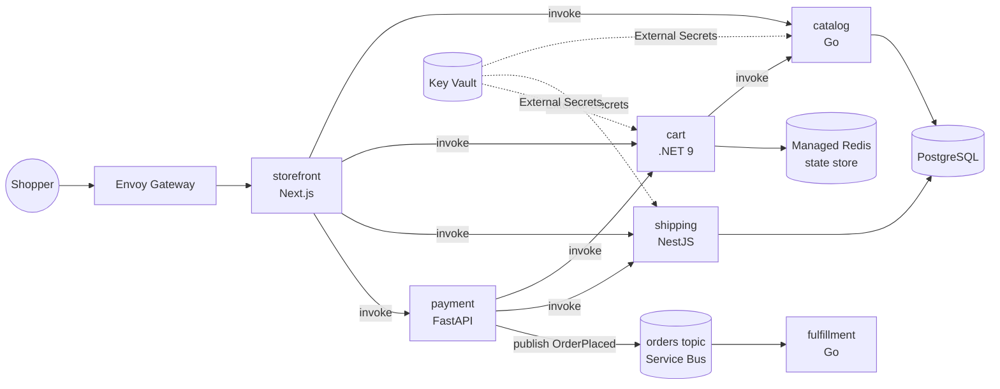

# Sprocketry

[](https://github.com/mchittineni/sprocketry/actions/workflows/services.yml)
[](LICENSE)
[](https://github.com/mchittineni/sprocketry/pulls)

[](https://buymeacoffee.com/mchittineni)
[](https://github.com/sponsors/mchittineni)

A polyglot microservices shop for practising cloud-native platform engineering. It's inspired by [instana/robot-shop](https://github.com/instana/robot-shop), rebuilt on a current stack that integrates easily with cloud services.

Services talk to infrastructure only through **Dapr**. Pub/sub, state and service discovery are YAML components, so the same code runs on Valkey locally and on Azure Service Bus and Azure Managed Redis in the cloud.

## Architecture



| Service | Language | Owns | robot-shop equivalent |
|---|---|---|---|
| storefront | TypeScript, Next.js 15 / React 19 | UI, server actions | web |
| catalog | Go 1.23 | products (PostgreSQL) | catalogue |
| cart | C#, .NET 9 minimal API | carts (Dapr state store) | cart |
| shipping | TypeScript, NestJS 11 | cities, distance pricing (PostgreSQL) | shipping |
| payment | Python 3.13, FastAPI | checkout, publishes `OrderPlaced` | payment |
| fulfillment | Go 1.23 | consumes `orders` topic | dispatch |

Payment and fulfillment have fault-injection settings (`PAYMENT_FAILURE_RATE`, `PAYMENT_DELAY_MS`, `DISPATCH_MAX_DELAY_MS`) for practising observability and incident response.

## Platform

| Concern | Local | Azure |
|---|---|---|
| Runtime | Docker Compose + Dapr sidecars | AKS (Azure CNI overlay + Cilium) + Dapr extension |
| Pub/sub | Valkey | Azure Service Bus (Entra ID auth, no keys) |
| State | Valkey | Azure Managed Redis |
| Database | Postgres 17 container | PostgreSQL Flexible Server (VNet-integrated) |
| Secrets | plain env | **Azure Key Vault** → External Secrets Operator → Kubernetes Secret |
| Identity | n/a | AKS workload identity (federated, no stored credentials) |
| Ingress | port 3000 | Envoy Gateway (Gateway API) |
| Delivery | `make up` | GitHub Actions (OIDC) → ACR → Argo CD |
| IaC | n/a | **Terraform** (`infra/azure`) |

## Quick start (local)

Requires Docker.

```bash
make up            # builds all images and starts the stack
open http://localhost:3000
make smoke         # optional, requires k6
make down
```

## Deploy to Azure

Requires the Azure CLI, Terraform ≥ 1.15, Helm, kubectl and jq.

```bash
az login
./scripts/bootstrap-tfstate.sh                    # once: remote state storage

cd infra/azure/envs/dev
cp terraform.tfvars.example terraform.tfvars      # set subscription_id and owner
terraform init && terraform apply
cd -

# Fill in the chart values from the Terraform outputs, then commit the file
cp deploy/helm/sprocketry/values-azure.example.yaml deploy/helm/sprocketry/values-azure.yaml
terraform -chdir=infra/azure/envs/dev output

./scripts/bootstrap-cluster.sh                    # External Secrets, Envoy Gateway, Argo CD
```

For CI, create an Entra ID app with a federated credential for this repo. Then set these repository variables: `AZURE_CLIENT_ID`, `AZURE_TENANT_ID`, `AZURE_SUBSCRIPTION_ID` and `ACR_NAME`.

### How secrets flow

1. Terraform generates the Postgres password and reads the Redis key, then writes connection strings to **Key Vault**. Nothing secret is stored in Git or CI.
2. External Secrets Operator authenticates to Key Vault with its own workload identity and syncs `sprocketry-secrets` into the `sprocketry` namespace.
3. Pods read `DATABASE_URL` from that Secret. The Dapr Redis component references it with `secretKeyRef`.
4. Service Bus uses no secret at all: the Dapr sidecar authenticates with the `apps` workload identity.

## Repository layout

```
services/<name>/        source, Dockerfile, tests
deploy/helm/            app chart: deployments, Dapr components, ExternalSecret, HTTPRoutes
deploy/dapr/local/      Dapr components for docker compose
deploy/argocd/          Argo CD application
deploy/gateway/         Gateway API entry point
infra/azure/modules/    network, aks, postgres, redis, servicebus, keyvault, workload-identity
infra/azure/envs/dev/   dev environment composition
loadgen/                k6 scenarios
scripts/                one-time bootstrap scripts
```

## Roadmap

- [ ] `reviews` service (Rust, Axum) and `profile` service with Keycloak OIDC
- [ ] OpenTelemetry Collector and Grafana LGTM stack (Dapr tracing is already wired via `observability.otlpEndpoint`)
- [ ] SLOs as code and burn-rate alerts
- [ ] Argo Rollouts canary releases, OpenFeature + flagd for runtime fault toggles
- [ ] Chaos Mesh experiments
- [ ] Kyverno policies, image signing with Cosign, SBOMs
- [ ] `assistant` service: RAG over the catalog with pgvector
- [ ] AWS (`infra/aws`) and GCP (`infra/gcp`), which need only new Dapr components and Terraform
