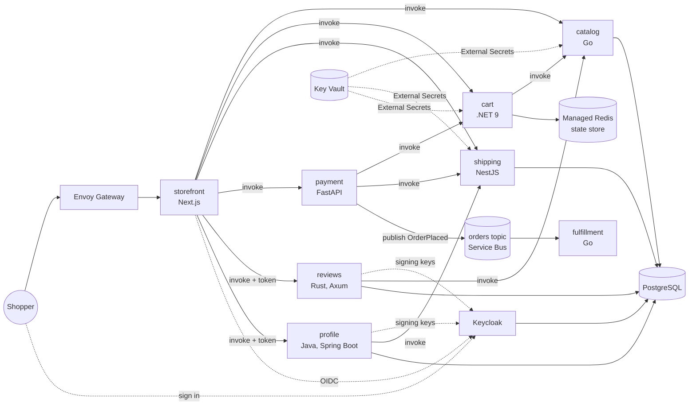

# Sprocketry

[](https://github.com/mchittineni/sprocketry/actions/workflows/services.yml)
[](LICENSE)
[](https://github.com/mchittineni/sprocketry/pulls)

[](https://buymeacoffee.com/mchittineni)
[](https://github.com/sponsors/mchittineni)

A polyglot microservices shop for practising cloud-native platform engineering. It's inspired by [instana/robot-shop](https://github.com/instana/robot-shop), rebuilt on a current stack that integrates easily with cloud services.

Services talk to infrastructure only through **Dapr**. Pub/sub, state and service discovery are YAML components, so the same code runs on Valkey locally and on Azure Service Bus and Azure Managed Redis in the cloud.

## Architecture



| Service | Language | Owns | robot-shop equivalent |
|---|---|---|---|
| storefront | TypeScript, Next.js 16 / React 19 | UI, server actions | web |
| catalog | Go 1.27 | products (PostgreSQL) | catalogue |
| cart | C#, .NET 10 minimal API | carts (Dapr state store) | cart |
| shipping | TypeScript, NestJS 12 | cities, distance pricing (PostgreSQL) | shipping |
| payment | Python 3.14, FastAPI | checkout, publishes `OrderPlaced` | payment |
| fulfillment | Go 1.27 | consumes `orders` topic | dispatch |
| reviews | Rust 1.99, Axum | product ratings and reviews (PostgreSQL); writing one needs a sign-in | ratings |
| profile | Java 25, Spring Boot 4 | shopper's name and default shipping city (PostgreSQL) | user |

For practising observability and incident response, payment has fault flags (`payment-failure-rate`, `payment-delay-ms`) that change while it runs, and fulfillment has a random dispatch delay (`DISPATCH_MAX_DELAY_MS`).

## Platform

| Concern | Local | Azure | AWS | Google Cloud |
|---|---|---|---|---|
| Runtime | Docker Compose + Dapr sidecars | AKS (Azure CNI overlay + Cilium) + Dapr extension | EKS + Dapr (Helm) | GKE Standard (Dataplane V2) + Dapr (Helm) |
| Pub/sub | Valkey | Azure Service Bus (Entra ID auth, no keys) | SNS + SQS | Pub/Sub |
| State | Valkey | Azure Managed Redis | ElastiCache for Valkey (TLS + auth token) | Memorystore for Redis (TLS + AUTH) |
| Database | Postgres 18 container | PostgreSQL Flexible Server 18 (VNet-integrated) | RDS for PostgreSQL 18 (private) | Cloud SQL for PostgreSQL 18 (private IP) |
| Secrets | plain env | **Azure Key Vault** → External Secrets Operator → Kubernetes Secret | Secrets Manager → External Secrets | Secret Manager → External Secrets |
| Identity | n/a | AKS workload identity (federated, no stored credentials) | EKS Pod Identity | Workload Identity Federation for GKE |
| Ingress | port 3000 | Envoy Gateway (Gateway API) |
| Delivery | `make up` | GitHub Actions (OIDC) → ACR → tag commit → Argo CD → Argo Rollouts canary | same, with ECR | same, with Artifact Registry |
| Fault flags | flagd container | flagd in the cluster (OpenFeature) | same | same |
| Sign-in | Keycloak container (localhost:8081) | Keycloak in the cluster, at `/auth` behind the gateway | same | same |
| Observability | OpenTelemetry Collector → Grafana LGTM container | Collector agent per node → in-cluster LGTM, or any OTLP backend | same | same |
| IaC | n/a | **Terraform** (`infra/azure`) | **Terraform** (`infra/aws`) | **Terraform** (`infra/gcp`) |

## Ways to run it

| Path | You need | Cost | Storefront |
|---|---|---|---|
| [Local stack](#quick-start-local) | Docker | free | http://localhost:3000 |
| [Local Kubernetes](#local-kubernetes-kind) | Docker, kind, kubectl, Helm | free | http://localhost:8080 |
| [Azure](#deploy-to-azure) | Azure subscription, Azure CLI, kubelogin, Terraform ≥ 1.15, Helm, kubectl, jq | billable | Gateway public IP |

Run `make doctor` (or `make doctor TARGET=kind|azure`) to check your machine first, and `make help` to list every target.
The [dev container](.devcontainer/devcontainer.json) has every tool preinstalled, including kind. Use it on Windows, or anywhere you don't want to install toolchains.

## Quick start (local)

Requires only Docker.

```bash
make up            # builds all images and starts the stack
open http://localhost:3000
open http://localhost:3001   # Grafana (admin/admin): Sprocketry → Sprocketry services
open http://localhost:8081/admin   # Keycloak admin console (admin/admin)
make smoke         # k6 load test; uses the grafana/k6 container if k6 isn't installed
make down
```

`make up-prebuilt` starts the same stack from the images CI publishes to GHCR, so nothing is compiled locally.

To change ports or the image source, copy [.env.example](.env.example) to `.env` and edit it.

### Fault flags

Payment reads two [OpenFeature](https://openfeature.dev) flags on every checkout, served by [flagd](https://flagd.dev) from [faults.json](deploy/helm/sprocketry/files/flagd/faults.json): `payment-failure-rate` fails a share of checkouts with a 502, and `payment-delay-ms` adds latency. Payment evaluates them in-process from a copy flagd streams to it, so a checkout makes no extra call, and without flagd every flag reads its default: no faults. Change them while the stack runs:

```bash
make fault                                            # list the flags and the variant each serves
make fault FLAG=payment-failure-rate VARIANT=20pct    # a fifth of checkouts now fail
./scripts/fault.sh reset                              # every flag back to off
```

Locally this rewrites `faults.json`, which flagd reloads within a second; `reset` puts it back. On kind it edits the `flagd-flags` ConfigMap, which takes up to a minute to reach flagd. On a cluster Argo CD syncs, change the file in Git instead, because Argo CD reverts edits made in the cluster.

With the stack running, `make e2e` checks the services together through their real Dapr sidecars: cart updates under concurrency, stock limits, that a checkout submitted twice places one order, that a fault flag applies without a restart, and sign-in.

`make test` lints and tests every service, and needs Go, golangci-lint, .NET, Node and Python installed. `make test-docker` runs the same checks in their official toolchain containers instead, including a throwaway PostgreSQL for catalog's database tests (`make test` skips those unless `TEST_DATABASE_URL` points at a disposable database).

## Local Kubernetes (kind)

Runs the Helm chart on a local cluster with `cloud: local`. Dapr components point at in-cluster Valkey, Postgres runs in the cluster, and the database URLs come from a plain Secret instead of Key Vault. No cloud account is needed.

```bash
make kind-up       # kind cluster + Dapr + build/load images + helm install
open http://localhost:8080
make smoke BASE_URL=http://localhost:8080
make grafana       # Grafana on http://localhost:3001 (admin/admin)
make kind-down
```

Data lives in `emptyDir` volumes, so it resets when the Postgres or Valkey pods restart.

### Canary releases

With `rollouts.enabled`, each service is an [Argo Rollouts](https://argoproj.github.io/rollouts/) Rollout instead of a Deployment. A new version takes 25% of the service's pods, then 50%, two minutes each, then all of them. There is no traffic router: Dapr spreads calls over every pod of a service, so the weight is the share of pods running the new version (at least one).

For the whole release an analysis queries Prometheus about the new pods' requests, counted by their Dapr sidecars: the share that fail with a 5xx, and the share slower than the service's latency objective (`latencyObjectiveMs`, the threshold of its SLO). If either is above 5% on two measurements, Argo Rollouts aborts the release and scales the new version away, while the old one keeps serving. A window with no requests to the new pods passes, since there is nothing to judge. The storefront has no analysis: browsers reach it directly, not through its sidecar, so its sidecar counts no requests. Its releases step through the weights unchecked.

```bash
make canary-demo   # about fifteen minutes, with checkouts running throughout
```

The demo releases a payment image tagged `faulty`, which the shipped fault flags fail on every checkout, and one tagged `slow`, which they delay by 1.5s without failing. The analysis rolls back both. After each it reverts, as you would revert the commit, and finally it releases a good version, which is promoted. `kubectl argo rollouts get rollout payment -n sprocketry --watch` shows a release step by step, if you have the [kubectl plugin](https://argoproj.github.io/argo-rollouts/installation/#kubectl-plugin-installation).

Switching an existing install to Rollouts replaces each Deployment with a Rollout, so the services restart once.

### Chaos experiments

[Chaos Mesh](https://chaos-mesh.org) experiments in [deploy/chaos](deploy/chaos) test how the app behaves when part of it breaks. Each file states a hypothesis, and `scripts/chaos.sh` checks it: it measures the steady state, injects the fault, probes while it lasts, and checks the recovery. It exits non-zero when the hypothesis doesn't hold, and removes the fault when it exits.

```bash
make chaos                                  # list the experiments and their hypotheses
make chaos EXPERIMENT=cart-pod-kill         # run one (installs Chaos Mesh on first use)
```

| Experiment | Fault | What it checks |
|---|---|---|
| `cart-pod-kill` | Kills the cart pod | Carts survive in Valkey, and cart answers again within a minute |
| `cart-valkey-partition` | Cuts cart off from Valkey for 45s | Cart fails within 10s instead of hanging, and recovers without a restart |
| `shipping-latency` | Adds 1.2s to shipping's network | Checkouts slow down, and payment's latency SLO page alert fires within ten minutes |

Two experiments refuted their hypotheses the first time, and both findings are fixed:

- **`cart-valkey-partition`:** with Valkey unreachable, cart waited more than 30 seconds for an answer. A Dapr [Resiliency](https://docs.dapr.io/operations/resiliency/) policy now limits every state store call to 2 seconds, for cart and the storefront's sessions, so cart answers with an error instead and recovers as soon as Valkey is back.
- **`shipping-latency`:** the latency page never fired, because checkouts didn't slow down; they failed. Shipping's probes used Kubernetes' default 1-second timeout, so the kubelet restarted a healthy but slow shipping five times, and payment's quotes failed while it was down. The probes now allow 3 seconds (liveness 5 seconds, three times), so a slow service stays up and the latency alert fires after about a minute. The experiment now also checks that checkouts succeed and that shipping isn't restarted.

They run against the kind cluster only. On a shared cluster, agree the blast radius first: these act on every pod the selector matches.

## Sign-in

Shoppers sign in with [Keycloak](https://www.keycloak.org) through OpenID Connect. Select **Sign in** on the storefront, then **Register** on Keycloak's page to create a shopper. Signed in, you can review robots on their product pages, and set a name and default shipping city under your account, which checkout then preselects.

- **Storefront:** authorization code flow with PKCE, as a confidential client. Tokens never reach the browser: the session lives in the Dapr state store, and the browser holds only a random session id in an `httpOnly` cookie. Access tokens refresh shortly before they expire, and **Sign out** ends the Keycloak session too.
- **reviews and profile** check every access token themselves: RS256 signature against Keycloak's published keys, exact issuer, the `sprocketry-api` audience, and expiry. The storefront forwards the token through Dapr service invocation. Reading reviews needs no sign-in.
- **The realm** is code: [deploy/helm/sprocketry/files/keycloak/sprocketry-realm.json](deploy/helm/sprocketry/files/keycloak/sprocketry-realm.json), imported on Keycloak's first start by both the local stack and the chart. Its client secret and storefront address come from the environment.
- **Addresses:** browsers reach Keycloak at its public address, which tokens name as their issuer, while services reach it inside the network. Keycloak answers each with the right one (`KC_HOSTNAME` plus dynamic back-channel URLs).

On Kubernetes, `auth.enabled` turns this on, together with the reviews and profile services. kind publishes Keycloak on http://localhost:8081 (an existing kind cluster needs `make kind-down` first to pick up the new port). On Azure, Keycloak shares the storefront's hostname at `/auth`, and its secrets and databases come from Terraform and Key Vault. Serve the gateway over HTTPS before real use: the realm refuses sign-in over plain HTTP from the internet. Keycloak runs one replica, and on Azure it uses the PostgreSQL admin login, because azurerm can't create database roles. Both are fine for a dev environment and worth changing for anything longer-lived.

`make e2e` signs in through the storefront the way a browser does, and checks that reviews and profile refuse missing, wrong-realm and wrong-audience tokens.

## Observability

Every signal goes through an OpenTelemetry Collector to Grafana's LGTM stack: Loki for logs, Grafana, Tempo for traces and Prometheus for metrics.

| Signal | Source |
|---|---|
| Traces | Dapr sidecars, over OTLP, for every service invocation and pub/sub message |
| Metrics | each Dapr sidecar's Prometheus endpoint: request rates, status codes, latency histograms, pub/sub counts |
| Logs | every container's stdout, labelled with `service.name` (`<app>` or `<app>-dapr` for its sidecar) |

The **Sprocketry services** dashboard shows request rate, 5xx ratio and latency per service, calls between services, the orders topic and logs. Its JSON lives in [deploy/helm/sprocketry/files/dashboards](deploy/helm/sprocketry/files/dashboards), and the local stack and the chart both load it from there.

On Kubernetes the collector runs as a DaemonSet that reads only its own node's pods, and the chart enables an in-cluster LGTM for kind and the Azure dev cluster. That LGTM keeps data in the pod, so it is lost when the pod restarts. For anything longer-lived, set `observability.lgtm.enabled: false` and point `observability.collector.exportEndpoint` at a managed OTLP backend.

### SLOs and alerts

The SLOs are code: one [Sloth](https://sloth.dev) spec per service in [deploy/slo/specs](deploy/slo/specs). `make slo` turns them into Prometheus recording and alerting rules in [deploy/helm/sprocketry/files/prometheus/rules](deploy/helm/sprocketry/files/prometheus/rules), which the Prometheus in LGTM evaluates in both the local stack and the chart. Commit the generated rules with the spec. CI fails if they are out of date. `make slo-test` regenerates the rules, validates them and runs the [promtool alert tests](deploy/slo/tests/burn-rate.test.yaml).

Each SLI is measured by the Dapr sidecar, over the requests it delivers to its app (`dapr_http_client_*`), across a 30-day window:

| Service | Availability: no 5xx | Latency |
|---|---|---|
| catalog | 99.5% | 99% within 250ms |
| cart | 99.5% | 99% within 250ms |
| shipping | 99.5% | 99% within 250ms |
| payment | 99.5% | 99% within 1s |
| fulfillment | 99.5% | none: it consumes the orders topic and no user waits on it |
| reviews | 99.5% | 99% within 250ms |
| profile | 99.5% | 99% within 250ms |

The storefront has no SLO yet: browser traffic reaches it directly, not through its sidecar. These targets are a starting point, not measured from history. Revisit them each quarter: tighten an SLO that never spends budget, and loosen one (or fix the service) that keeps running out.

Each SLO has two multiwindow, multi-burn-rate alerts, following the Google SRE Workbook:

| Alert | Fires when the budget burns at | Measured over | Meaning |
|---|---|---|---|
| `severity: page` | 14.4x, or 6x | 1h and 5m, or 6h and 30m | 2% of the month's budget gone in an hour, or 5% in six hours. Act now. |
| `severity: ticket` | 3x, or 1x | 1d and 2h, or 3d and 6h | On course to spend the budget before the month ends. Look during working hours. |

The short window makes an alert clear soon after the problem stops, and the long one keeps a brief spike from paging anyone. The alerts show in the **Sprocketry SLOs** dashboard and under Alerting → Alert rules (data source-managed). There is no Alertmanager, so nothing is sent anywhere yet. To try one, run `make fault FLAG=payment-failure-rate VARIANT=20pct` and place some orders: the payment availability page alert fires within a few minutes.

Error budget policy:

- **Budget left:** ship as usual.
- **Page alert:** stop feature work on that service and mitigate first, for example by rolling back to the previous image tag in Argo CD.
- **Budget spent (remaining at or below 0):** only reliability fixes ship to that service until its SLI has been back above the objective for 7 days. Any incident that spent more than 20% of a budget gets a written postmortem.

Things to know:

- Dapr labels HTTP metrics by method and status only (`increasedCardinality: false`). With the request path as a label, every cart ID became its own series, which `rate()` can't count.
- If a service is down entirely, its sidecar delivers nothing, so its SLI has no data and its alerts stay quiet. The callers' SLOs (payment, for example) still notice.
- With little traffic, a couple of failures are a large share, so a quiet service can page on a handful of errors.
- The in-cluster and local LGTM lose their data on restart, so the 30-day figures only cover the time since then.
- `deploy/helm/sprocketry/files/prometheus/prometheus.yaml` replaces the LGTM image's Prometheus config to add the rules. Compare it with the image's own file whenever you upgrade `grafana/otel-lgtm`. With an external backend, load the rule files into its ruler (Mimir, Azure Monitor managed Prometheus, or a `PrometheusRule`) instead.

## Deploy to Azure

> **This creates billable resources.** An AKS cluster (Free tier control plane, 1–3 `Standard_D4s_v5` nodes),
> PostgreSQL Flexible Server `B_Standard_B1ms`, Azure Managed Redis `Balanced_B0`, Service Bus Standard,
> Key Vault, ACR Basic and a public load balancer. The nodes run around the clock, so tear down when you're done
> (see [Tear down](#tear-down)). Use the [Azure pricing calculator](https://azure.microsoft.com/pricing/calculator/) for current prices in your region.

Fork the repo first. Argo CD deploys from Git, so it needs a repo you can push to, and that repo must be public
(or you add repo credentials to Argo CD).

```bash
make doctor TARGET=azure
az login
./scripts/bootstrap-tfstate.sh                    # once: state storage + infra/azure/envs/dev/backend.hcl

cd infra/azure/envs/dev
cp terraform.tfvars.example terraform.tfvars      # set subscription_id, owner and deployer_principal_ids
terraform init -backend-config=backend.hcl
terraform apply
cd -

./scripts/bootstrap-cluster.sh                    # writes values-azure.yaml, installs External Secrets, Envoy Gateway, Argo CD
git add deploy/helm/sprocketry/values-azure.yaml && git commit -m "chore: azure values" && git push
```

`bootstrap-cluster.sh` fills `values-azure.yaml` from the Terraform outputs and points Argo CD at your clone's `origin`.
It installs pinned versions of External Secrets, Envoy Gateway and Argo CD. You can override each version with an environment variable at the top of the script.

The cluster has no local admin account. kubectl signs in through Entra ID using your `az login`, which is why kubelogin is needed (`az aks install-cli` installs it).
Everyone in `deployer_principal_ids` gets cluster admin and can write Key Vault secrets. Add the CI service principal's object ID too, so that CI's `terraform plan` matches your applies.
It finishes by printing the storefront's public URL.

### CI

Every push to `main` publishes images to `ghcr.io/<owner>/<repo>/<service>` using the built-in `GITHUB_TOKEN`, so forks need no setup.
New GHCR packages are private. To let others pull them, set each package's visibility to public in its settings.

To also push to ACR and run `terraform plan` on pull requests, create an Entra ID app with a federated credential for your repo.
Then set these repository variables:

| Variable | Value |
|---|---|
| `AZURE_CLIENT_ID`, `AZURE_TENANT_ID`, `AZURE_SUBSCRIPTION_ID` | the Entra ID app and your subscription |
| `ACR_NAME` | registry name, without `.azurecr.io` (`terraform output acr_login_server`) |
| `TFSTATE_ACCOUNT` | printed by `bootstrap-tfstate.sh` |
| `TFSTATE_RESOURCE_GROUP` | optional; defaults to `rg-terraform-state` |
| `DEPLOYER_PRINCIPAL_IDS` | the same list as `deployer_principal_ids` in your tfvars, as JSON, e.g. `["<you>","<ci-sp>"]` |
| `TF_OWNER` | the same value as `owner` in your tfvars; defaults to the repo owner |

When these variables aren't set, the Azure steps are skipped instead of failing.

To push images to ECR or Artifact Registry too, set that cloud's variables. As with Azure, create the CI identity yourself: an IAM role GitHub's OIDC provider can assume, with ECR push rights, or a Workload Identity Federation provider and a service account with `roles/artifactregistry.writer`.

| Variable | Value |
|---|---|
| `ECR_REGISTRY`, `AWS_REGION`, `AWS_ROLE_ARN` | `terraform output ecr_registry`, its region, and the CI role |
| `GAR_REPOSITORY`, `GCP_WORKLOAD_IDENTITY_PROVIDER`, `GCP_SERVICE_ACCOUNT` | `terraform output artifact_registry`, the provider's full name, and the CI service account |

Terraform for every cloud is checked offline on each pull request (format, validate, plan tests with mocked providers, TFLint, Trivy), with no credentials. Only Azure also gets a real `terraform plan`.

Other checks that run without any setup:

- **Services** ([services.yml](.github/workflows/services.yml)): each changed service is linted (golangci-lint, `dotnet format` with analyzers, ESLint, ruff) and tested, catalog against a real PostgreSQL. Then the whole stack runs under Docker Compose for `make e2e`.
- **Images:** each service is scanned with Trivy before it is pushed. A fixable CRITICAL vulnerability fails the build. Pushed images carry SBOM and provenance attestations.
- **Chart** ([chart.yml](.github/workflows/chart.yml)): `helm lint`, kubeconform schema validation, and a smoke test that deploys the chart to kind and loads the storefront.
- **Misconfiguration scans:** Trivy scans the chart and Terraform and reports its findings without blocking.

The chart adds PodDisruptionBudgets for services with more than one replica. It also adds default-deny ingress NetworkPolicies. They also apply in local mode; they've been tested on kind. Turn them off with `networkPolicy.enabled: false`.

> **Upgrading an existing environment:** the defaults now create PostgreSQL 18. For a server that already runs 17, set `create_mode = "Update"` on it for that apply. That upgrades it in place; without it, Terraform replaces the server and its data.

### How a change reaches the cluster

1. A push to `main` that touches a service builds and scans only the services that changed, then pushes each image tagged with the commit SHA.
2. Once every build succeeds, the `promote` job pins those services to that SHA in [values-image-tags.yaml](deploy/helm/sprocketry/values-image-tags.yaml) and commits the file to `main`.
3. Argo CD sees the commit and updates each changed service's Rollout, which releases the new image as a canary (see [Canary releases](#canary-releases)) and rolls it back if its requests fail. Services that haven't changed keep their pinned tags.

To roll back, revert the promote commit. If `main` is protected, allow `github-actions[bot]` to push to it, or change the promote step to open a PR.

### Tear down

```bash
make azure-destroy                                # everything Terraform created
az group delete -n rg-terraform-state             # optional: the state storage account
```

### How secrets flow

1. Terraform generates the Postgres password and reads the Redis key, then writes connection strings to **Key Vault**. Nothing secret is stored in Git or CI.
2. External Secrets Operator authenticates to Key Vault with its own workload identity and syncs `sprocketry-secrets` into the `sprocketry` namespace.
3. Pods read `DATABASE_URL` from that Secret. The Dapr Redis component references it with `secretKeyRef`.
4. Service Bus uses no secret at all: the Dapr sidecar authenticates with the `apps` workload identity.

## Deploy to AWS or Google Cloud

The same chart runs on EKS and GKE with `cloud: aws` or `cloud: gcp`: only the Dapr components, the secret store and the Terraform change. The steps follow [Deploy to Azure](#deploy-to-azure), with `CLOUD` set:

```bash
make doctor TARGET=aws                            # or gcp
CLOUD=aws ./scripts/bootstrap-tfstate.sh          # once: S3 (or GCS) bucket + infra/aws/envs/dev/backend.hcl

cd infra/aws/envs/dev
cp terraform.tfvars.example terraform.tfvars      # fill in, see the comments in the file
terraform init -backend-config=backend.hcl
terraform apply
cd -

CLOUD=aws ./scripts/bootstrap-cluster.sh          # writes values-aws.yaml, installs Dapr and the add-ons, starts Argo CD
git add deploy/helm/sprocketry/values-aws.yaml && git commit -m "chore: aws values" && git push
```

> **This creates billable resources** on either cloud: a Kubernetes cluster with nodes running around the clock, a managed PostgreSQL, a managed Redis/Valkey, messaging, secrets and a load balancer. Tear down with `terraform destroy` when you're done.

What differs from Azure:

- **AWS:**
  - The services and External Secrets get their IAM roles from EKS Pod Identity, so no service account needs an annotation.
  - RDS creates only the `catalog` database. A Job in the chart creates the others (`aws.databases`); the services that need them restart until it has run.
  - The EKS API endpoint is reachable only from `cluster_endpoint_public_access_cidrs`, and only for the IAM principals in `deployer_principal_arns`.
  - EKS has no node autoscaler built in: the node group stays at its desired size until you install Cluster Autoscaler or Karpenter.
- **Google Cloud:**
  - IAM is granted to the Kubernetes service accounts directly (Workload Identity Federation for GKE), again with no annotations.
  - Memorystore accepts only TLS, signed by a CA of its own that no system trusts. Dapr's Redis component can't be given a CA, so the chart mounts it into the sidecars of the services that use the state store, through `SSL_CERT_DIR`. If the server's certificate turns out not to match, set `gcp.redisSkipTlsVerify: true`: traffic stays encrypted, but the server isn't verified.
  - kubectl reaches the control plane through its IAM-checked DNS endpoint (`--dns-endpoint`); its IP endpoint is closed unless you list CIDRs in `master_authorized_cidrs`.
- **Both:**
  - Secret names, topics and queues have no environment prefix, so each environment needs its own AWS account and region, or its own GCP project.
  - Neither has had a real `terraform plan` or `apply` yet, only the offline checks above. Expect a first apply to surface quota, region or version availability issues.

## Troubleshooting

| Symptom | Fix |
|---|---|
| `port is already allocated` on `make up` | Set `STOREFRONT_PORT` in `.env`, or stop whatever uses port 3000. |
| Storefront shows an error right after `make up` | Services and their Dapr sidecars can take a few seconds to become ready. Wait, then reload. `make logs` shows progress. |
| A page errors after rebuilding one service with `docker compose up --build <service>` | Its Dapr sidecar is still attached to the old container. Use `make rebuild SVC=<service>`, which recreates both. |
| `make up-prebuilt` fails with `denied` or `not found` | The images aren't published, or the GHCR packages are private. Use `make up`, or set `REGISTRY` in `.env` to your own published images. |
| `make kind-up` times out | Check `kubectl get pods -n sprocketry`. On the first run, image builds and the Dapr install can be slow. Run it again, since every step is idempotent. |
| `terraform init` asks for a storage account | Run `./scripts/bootstrap-tfstate.sh`, then `terraform init -backend-config=backend.hcl`. |
| Argo CD shows `values-azure.yaml` not found | Commit and push the generated file to the repo Argo CD tracks. |

## Repository layout

```
services/<name>/        source, Dockerfile, tests
deploy/helm/            app chart: deployments, Dapr components, ExternalSecret, HTTPRoutes
deploy/dapr/local/      Dapr components for docker compose
deploy/dapr/local-config/  Dapr sidecar configuration (tracing, metrics) for docker compose
deploy/slo/             SLO specs (Sloth) and their alert tests; `make slo` generates the Prometheus rules
deploy/chaos/           Chaos Mesh experiments, run and checked by scripts/chaos.sh
deploy/observability/   OpenTelemetry Collector and Grafana provisioning for docker compose
deploy/helm/sprocketry/values-local.yaml   values for a local cluster (cloud: local)
deploy/kind/            kind cluster config
deploy/argocd/          Argo CD application
deploy/gateway/         Gateway API entry point
infra/azure/modules/    network, aks, postgres, redis, servicebus, keyvault, workload-identity
infra/azure/envs/dev/   dev environment composition
infra/aws/              network, eks, postgres, valkey, messaging, secrets, pod-identity; envs/dev
infra/gcp/              network, gke, cloudsql, memorystore, pubsub, secrets, workload-identity; envs/dev
loadgen/                k6 scenarios
scripts/                doctor, kind-up, e2e, fault flags, canary demo, chaos and one-time Azure bootstrap scripts
```

## Roadmap

- [x] `reviews` service (Rust, Axum) and `profile` service with Keycloak OIDC
- [x] OpenTelemetry Collector and Grafana LGTM stack
- [x] SLOs as code and burn-rate alerts
- [x] Argo Rollouts canary releases, OpenFeature + flagd for runtime fault toggles
- [x] Chaos Mesh experiments
- [ ] Kyverno policies, image signing with Cosign, SBOMs
- [ ] `assistant` service: RAG over the catalog with pgvector
- [x] AWS (`infra/aws`) and GCP (`infra/gcp`), which need only new Dapr components and Terraform
