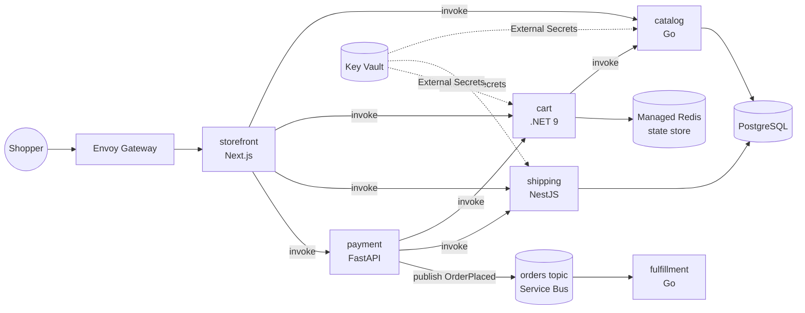

# Sprocketry

[](https://github.com/mchittineni/sprocketry/actions/workflows/services.yml)
[](LICENSE)
[](https://github.com/mchittineni/sprocketry/pulls)

[](https://buymeacoffee.com/mchittineni)
[](https://github.com/sponsors/mchittineni)

A polyglot microservices shop for practising cloud-native platform engineering. It's inspired by [instana/robot-shop](https://github.com/instana/robot-shop), rebuilt on a current stack that integrates easily with cloud services.

Services talk to infrastructure only through **Dapr**. Pub/sub, state and service discovery are YAML components, so the same code runs on Valkey locally and on Azure Service Bus and Azure Managed Redis in the cloud.

## Architecture



| Service | Language | Owns | robot-shop equivalent |
|---|---|---|---|
| storefront | TypeScript, Next.js 16 / React 19 | UI, server actions | web |
| catalog | Go 1.27 | products (PostgreSQL) | catalogue |
| cart | C#, .NET 10 minimal API | carts (Dapr state store) | cart |
| shipping | TypeScript, NestJS 12 | cities, distance pricing (PostgreSQL) | shipping |
| payment | Python 3.14, FastAPI | checkout, publishes `OrderPlaced` | payment |
| fulfillment | Go 1.27 | consumes `orders` topic | dispatch |

Payment and fulfillment have fault-injection settings (`PAYMENT_FAILURE_RATE`, `PAYMENT_DELAY_MS`, `DISPATCH_MAX_DELAY_MS`) for practising observability and incident response.

## Platform

| Concern | Local | Azure |
|---|---|---|
| Runtime | Docker Compose + Dapr sidecars | AKS (Azure CNI overlay + Cilium) + Dapr extension |
| Pub/sub | Valkey | Azure Service Bus (Entra ID auth, no keys) |
| State | Valkey | Azure Managed Redis |
| Database | Postgres 18 container | PostgreSQL Flexible Server 18 (VNet-integrated) |
| Secrets | plain env | **Azure Key Vault** → External Secrets Operator → Kubernetes Secret |
| Identity | n/a | AKS workload identity (federated, no stored credentials) |
| Ingress | port 3000 | Envoy Gateway (Gateway API) |
| Delivery | `make up` | GitHub Actions (OIDC) → ACR → tag commit → Argo CD |
| Observability | OpenTelemetry Collector → Grafana LGTM container | Collector agent per node → in-cluster LGTM, or any OTLP backend |
| IaC | n/a | **Terraform** (`infra/azure`) |

## Ways to run it

| Path | You need | Cost | Storefront |
|---|---|---|---|
| [Local stack](#quick-start-local) | Docker | free | http://localhost:3000 |
| [Local Kubernetes](#local-kubernetes-kind) | Docker, kind, kubectl, Helm | free | http://localhost:8080 |
| [Azure](#deploy-to-azure) | Azure subscription, Azure CLI, kubelogin, Terraform ≥ 1.15, Helm, kubectl, jq | billable | Gateway public IP |

Run `make doctor` (or `make doctor TARGET=kind|azure`) to check your machine first, and `make help` to list every target.
The [dev container](.devcontainer/devcontainer.json) has every tool preinstalled, including kind. Use it on Windows, or anywhere you don't want to install toolchains.

## Quick start (local)

Requires only Docker.

```bash
make up            # builds all images and starts the stack
open http://localhost:3000
open http://localhost:3001   # Grafana (admin/admin): Sprocketry → Sprocketry services
make smoke         # k6 load test; uses the grafana/k6 container if k6 isn't installed
make down
```

`make up-prebuilt` starts the same stack from the images CI publishes to GHCR, so nothing is compiled locally.

To change ports, image source or the fault-injection knobs, copy [.env.example](.env.example) to `.env` and edit it.
For example, `PAYMENT_FAILURE_RATE=0.2` makes 20% of checkouts fail.

With the stack running, `make e2e` checks the services together through their real Dapr sidecars: cart updates under concurrency, stock limits, and that a checkout submitted twice places one order.

`make test` lints and tests every service, and needs Go, golangci-lint, .NET, Node and Python installed. `make test-docker` runs the same checks in their official toolchain containers instead, including a throwaway PostgreSQL for catalog's database tests (`make test` skips those unless `TEST_DATABASE_URL` points at a disposable database).

## Local Kubernetes (kind)

Runs the Helm chart on a local cluster with `cloud: local`. Dapr components point at in-cluster Valkey, Postgres runs in the cluster, and the database URLs come from a plain Secret instead of Key Vault. No cloud account is needed.

```bash
make kind-up       # kind cluster + Dapr + build/load images + helm install
open http://localhost:8080
make smoke BASE_URL=http://localhost:8080
make grafana       # Grafana on http://localhost:3001 (admin/admin)
make kind-down
```

Data lives in `emptyDir` volumes, so it resets when the Postgres or Valkey pods restart.

## Observability

Every signal goes through an OpenTelemetry Collector to Grafana's LGTM stack: Loki for logs, Grafana, Tempo for traces and Prometheus for metrics.

| Signal | Source |
|---|---|
| Traces | Dapr sidecars, over OTLP, for every service invocation and pub/sub message |
| Metrics | each Dapr sidecar's Prometheus endpoint: request rates, status codes, latency histograms, pub/sub counts |
| Logs | every container's stdout, labelled with `service.name` (`<app>` or `<app>-dapr` for its sidecar) |

The **Sprocketry services** dashboard shows request rate, 5xx ratio and latency per service, calls between services, the orders topic and logs. Its JSON lives in [deploy/helm/sprocketry/files/dashboards](deploy/helm/sprocketry/files/dashboards), and the local stack and the chart both load it from there.

On Kubernetes the collector runs as a DaemonSet that reads only its own node's pods, and the chart enables an in-cluster LGTM for kind and the Azure dev cluster. That LGTM keeps data in the pod, so it is lost when the pod restarts. For anything longer-lived, set `observability.lgtm.enabled: false` and point `observability.collector.exportEndpoint` at a managed OTLP backend.

## Deploy to Azure

> **This creates billable resources.** An AKS cluster (Free tier control plane, 1–3 `Standard_D4s_v5` nodes),
> PostgreSQL Flexible Server `B_Standard_B1ms`, Azure Managed Redis `Balanced_B0`, Service Bus Standard,
> Key Vault, ACR Basic and a public load balancer. The nodes run around the clock, so tear down when you're done
> (see [Tear down](#tear-down)). Use the [Azure pricing calculator](https://azure.microsoft.com/pricing/calculator/) for current prices in your region.

Fork the repo first. Argo CD deploys from Git, so it needs a repo you can push to, and that repo must be public
(or you add repo credentials to Argo CD).

```bash
make doctor TARGET=azure
az login
./scripts/bootstrap-tfstate.sh                    # once: state storage + infra/azure/envs/dev/backend.hcl

cd infra/azure/envs/dev
cp terraform.tfvars.example terraform.tfvars      # set subscription_id, owner and deployer_principal_ids
terraform init -backend-config=backend.hcl
terraform apply
cd -

./scripts/bootstrap-cluster.sh                    # writes values-azure.yaml, installs External Secrets, Envoy Gateway, Argo CD
git add deploy/helm/sprocketry/values-azure.yaml && git commit -m "chore: azure values" && git push
```

`bootstrap-cluster.sh` fills `values-azure.yaml` from the Terraform outputs and points Argo CD at your clone's `origin`.
It installs pinned versions of External Secrets, Envoy Gateway and Argo CD. You can override each version with an environment variable at the top of the script.

The cluster has no local admin account. kubectl signs in through Entra ID using your `az login`, which is why kubelogin is needed (`az aks install-cli` installs it).
Everyone in `deployer_principal_ids` gets cluster admin and can write Key Vault secrets. Add the CI service principal's object ID too, so that CI's `terraform plan` matches your applies.
It finishes by printing the storefront's public URL.

### CI

Every push to `main` publishes images to `ghcr.io/<owner>/<repo>/<service>` using the built-in `GITHUB_TOKEN`, so forks need no setup.
New GHCR packages are private. To let others pull them, set each package's visibility to public in its settings.

To also push to ACR and run `terraform plan` on pull requests, create an Entra ID app with a federated credential for your repo.
Then set these repository variables:

| Variable | Value |
|---|---|
| `AZURE_CLIENT_ID`, `AZURE_TENANT_ID`, `AZURE_SUBSCRIPTION_ID` | the Entra ID app and your subscription |
| `ACR_NAME` | registry name, without `.azurecr.io` (`terraform output acr_login_server`) |
| `TFSTATE_ACCOUNT` | printed by `bootstrap-tfstate.sh` |
| `TFSTATE_RESOURCE_GROUP` | optional; defaults to `rg-terraform-state` |
| `DEPLOYER_PRINCIPAL_IDS` | the same list as `deployer_principal_ids` in your tfvars, as JSON, e.g. `["<you>","<ci-sp>"]` |
| `TF_OWNER` | the same value as `owner` in your tfvars; defaults to the repo owner |

When these variables aren't set, the Azure steps are skipped instead of failing.

Other checks that run without any setup:

- **Services** ([services.yml](.github/workflows/services.yml)): each changed service is linted (golangci-lint, `dotnet format` with analyzers, ESLint, ruff) and tested, catalog against a real PostgreSQL. Then the whole stack runs under Docker Compose for `make e2e`.
- **Images:** each service is scanned with Trivy before it is pushed. A fixable CRITICAL vulnerability fails the build. Pushed images carry SBOM and provenance attestations.
- **Chart** ([chart.yml](.github/workflows/chart.yml)): `helm lint`, kubeconform schema validation, and a smoke test that deploys the chart to kind and loads the storefront.
- **Misconfiguration scans:** Trivy scans the chart and Terraform and reports its findings without blocking.

The chart adds PodDisruptionBudgets for services with more than one replica. It also adds default-deny ingress NetworkPolicies. They also apply in local mode; they've been tested on kind. Turn them off with `networkPolicy.enabled: false`.

> **Upgrading an existing environment:** the defaults now create PostgreSQL 18. For a server that already runs 17, set `create_mode = "Update"` on it for that apply. That upgrades it in place; without it, Terraform replaces the server and its data.

### How a change reaches the cluster

1. A push to `main` that touches a service builds and scans only the services that changed, then pushes each image tagged with the commit SHA.
2. Once every build succeeds, the `promote` job pins those services to that SHA in [values-image-tags.yaml](deploy/helm/sprocketry/values-image-tags.yaml) and commits the file to `main`.
3. Argo CD sees the commit and rolls out the new image. Services that haven't changed keep their pinned tags.

To roll back, revert the promote commit. If `main` is protected, allow `github-actions[bot]` to push to it, or change the promote step to open a PR.

### Tear down

```bash
make azure-destroy                                # everything Terraform created
az group delete -n rg-terraform-state             # optional: the state storage account
```

### How secrets flow

1. Terraform generates the Postgres password and reads the Redis key, then writes connection strings to **Key Vault**. Nothing secret is stored in Git or CI.
2. External Secrets Operator authenticates to Key Vault with its own workload identity and syncs `sprocketry-secrets` into the `sprocketry` namespace.
3. Pods read `DATABASE_URL` from that Secret. The Dapr Redis component references it with `secretKeyRef`.
4. Service Bus uses no secret at all: the Dapr sidecar authenticates with the `apps` workload identity.

## Troubleshooting

| Symptom | Fix |
|---|---|
| `port is already allocated` on `make up` | Set `STOREFRONT_PORT` in `.env`, or stop whatever uses port 3000. |
| Storefront shows an error right after `make up` | Services and their Dapr sidecars can take a few seconds to become ready. Wait, then reload. `make logs` shows progress. |
| A page errors after rebuilding one service with `docker compose up --build <service>` | Its Dapr sidecar is still attached to the old container. Use `make rebuild SVC=<service>`, which recreates both. |
| `make up-prebuilt` fails with `denied` or `not found` | The images aren't published, or the GHCR packages are private. Use `make up`, or set `REGISTRY` in `.env` to your own published images. |
| `make kind-up` times out | Check `kubectl get pods -n sprocketry`. On the first run, image builds and the Dapr install can be slow. Run it again, since every step is idempotent. |
| `terraform init` asks for a storage account | Run `./scripts/bootstrap-tfstate.sh`, then `terraform init -backend-config=backend.hcl`. |
| Argo CD shows `values-azure.yaml` not found | Commit and push the generated file to the repo Argo CD tracks. |

## Repository layout

```
services/<name>/        source, Dockerfile, tests
deploy/helm/            app chart: deployments, Dapr components, ExternalSecret, HTTPRoutes
deploy/dapr/local/      Dapr components for docker compose
deploy/dapr/local-config/  Dapr sidecar configuration (tracing) for docker compose
deploy/observability/   OpenTelemetry Collector and Grafana provisioning for docker compose
deploy/helm/sprocketry/values-local.yaml   values for a local cluster (cloud: local)
deploy/kind/            kind cluster config
deploy/argocd/          Argo CD application
deploy/gateway/         Gateway API entry point
infra/azure/modules/    network, aks, postgres, redis, servicebus, keyvault, workload-identity
infra/azure/envs/dev/   dev environment composition
loadgen/                k6 scenarios
scripts/                doctor, kind-up and one-time Azure bootstrap scripts
```

## Roadmap

- [ ] `reviews` service (Rust, Axum) and `profile` service with Keycloak OIDC
- [x] OpenTelemetry Collector and Grafana LGTM stack
- [ ] SLOs as code and burn-rate alerts
- [ ] Argo Rollouts canary releases, OpenFeature + flagd for runtime fault toggles
- [ ] Chaos Mesh experiments
- [ ] Kyverno policies, image signing with Cosign, SBOMs
- [ ] `assistant` service: RAG over the catalog with pgvector
- [ ] AWS (`infra/aws`) and GCP (`infra/gcp`), which need only new Dapr components and Terraform
